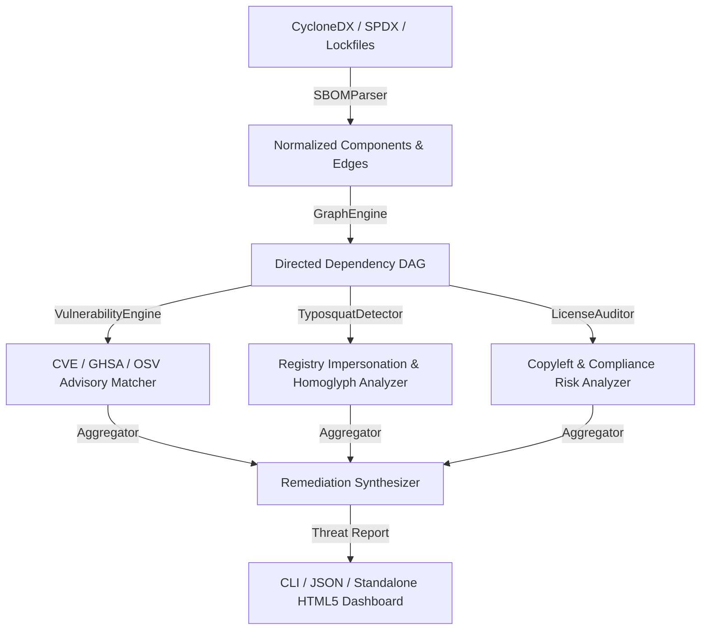

# SBOMsentry Architecture

## 1. System Overview
SBOMsentry is an Autonomous Software Supply Chain Security & SBOM Intelligence Platform. It ingests multi-format Software Bill of Materials (CycloneDX, SPDX, lockfiles), models dependency topologies in a directed graph, and simultaneously evaluates packages for vulnerabilities, typosquatting/impersonation attacks, license copyleft contamination, and synthesizes automated remediation PR diffs.

## 2. Architecture Diagram

## 3. Core Component Responsibilities
- **`core/models.py`**: Rich dataclasses for Components, Graph Nodes, Vulnerabilities, License Policies, and Audit Findings.
- **`core/sbom_parser.py`**: Unified parser handling CycloneDX v1.4/v1.5, SPDX v2.3, `requirements.txt`, and `package-lock.json`.
- **`core/graph_engine.py`**: Dependency DAG calculator resolving root vs direct vs transitive components, computing dependency paths, and cycle detection.
- **`analyzers/vulnerability_engine.py`**: Embedded vulnerability intelligence mapping version constraints against semantic version ranges and calculating CVSS v3.1 impact.
- **`analyzers/typosquat_detector.py`**: Computes normalized Levenshtein distances, keyboard proximity mutations, visual homoglyph substitutions, and separator variations against the top 1,000 canonical PyPI and npm libraries.
- **`analyzers/license_auditor.py`**: Categorizes licenses into Permissive, Weak Copyleft, Strong Copyleft, and Network Copyleft, flagging policy violations for commercial applications.
- **`analyzers/remediation_synthesizer.py`**: Generates exact version upgrade instructions and patch configurations to resolve vulnerability paths with minimal breaking changes.
- **`reporters/`**: Console summary tables with risk scoring, JSON for CI/CD gates, and interactive HTML5 executive dashboards.
