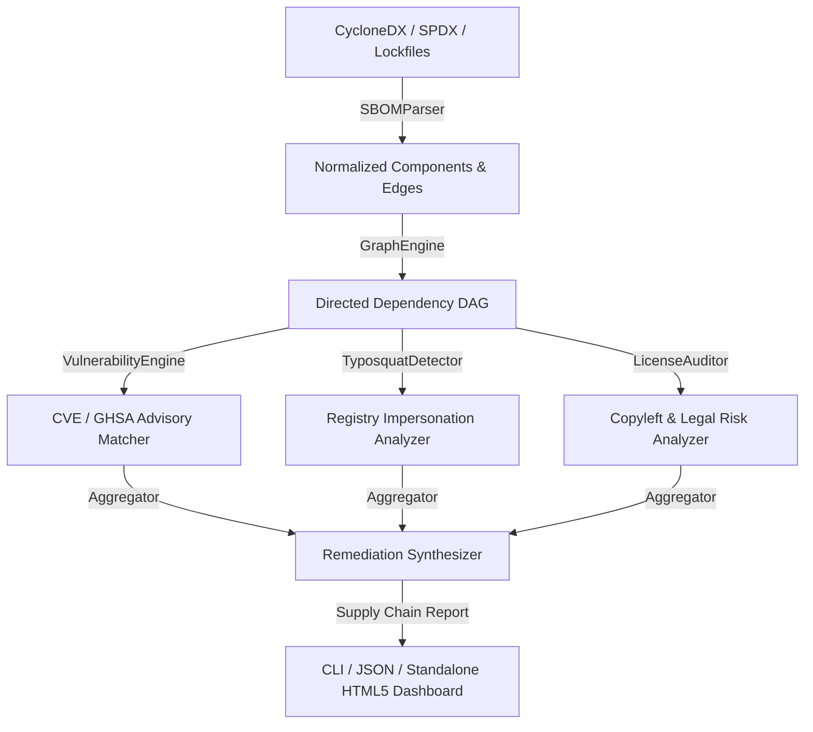

# SBOMsentry 🛡️

> **Status:** prototype. A personal security-research project, not a production product. Expect rough edges; issues and pull requests are welcome.

> **Autonomous Software Supply Chain Security & SBOM Intelligence Platform**

SBOMsentry is a prototype Software Supply Chain security platform. It ingests multi-format Software Bill of Materials (CycloneDX, SPDX, requirements.txt, and npm lockfiles), reconstructs dependency topology into a directed acyclic graph (DAG), and simultaneously performs automated vulnerability reachability tracing, typosquatting & impersonation detection, license compliance auditing, and minimal-breaking-change remediation synthesis.

---

## 🌟 Key Capabilities

- **Universal Multi-Format Ingestion**: Ingests CycloneDX (JSON/XML v1.4/v1.5), SPDX (JSON v2.3), Python `requirements.txt`, and npm `package-lock.json` (v1/v2/v3).
- **Dependency Graph & Reachability DAG**: Traces exact shortest paths from application root to nested transitive dependencies (`app -> direct-dep -> vulnerable-transitive-lib`).
- **Embedded Vulnerability Intelligence**: Correlates components with known high-severity CVEs, GHSAs, and OSV advisories with semver range evaluation and CVSS v3.1 scoring.
- **Typosquatting & Impersonation Defense**: Identifies malicious supply chain packages impersonating top PyPI and npm canonical libraries using normalized Levenshtein distances and visual homoglyph mutations (`req-uests`, `requsts`, `expres`).
- **License Compliance & Copyleft Policy**: Detects and flags high-risk Network Copyleft (AGPL-3.0, SSPL) and Strong Copyleft (GPL-2.0, GPL-3.0) licenses that compromise proprietary software.
- **Automated Remediation Engine**: Synthesizes pinpoint upgrade instructions and patch configurations (`pip install --upgrade`, `npm install`) prioritizing lowest non-breaking version increments.
- **Visual Reporting & CI Gate**: Generates formatted CLI reports, machine-readable JSON for DevSecOps pipelines, and standalone interactive HTML5 executive dashboards. Enforces strict build-breaking gates (`--fail-on-cvss 7.0`, `--fail-on-typosquat`).

---

## 📐 Architecture



---

## 🚀 Quick Start

### 1. Installation

```bash
git clone https://github.com/csenta/sbomsentry.git
cd sbomsentry
pip install -r requirements.txt
```

### 2. Comprehensive Supply Chain Audit

```bash
python3 -m sbomsentry.cli scan \
  --input examples/cyclonedx_sbom.json \
  --output-json report.json \
  --output-html report.html
```

### 3. Trace Dependency Reachability

```bash
python3 -m sbomsentry.cli graph \
  --input examples/cyclonedx_sbom.json \
  --target-component urllib3
```

Output:
```text
📦 Dependency Reachability Path for 'urllib3':
   enterprise-billing-service -> requests -> urllib3
```

### 4. Synthesize Automated Remediation Plan

```bash
python3 -m sbomsentry.cli remediate \
  --input examples/cyclonedx_sbom.json
```

### 5. Enforce CI/CD Quality Gate

```bash
python3 -m sbomsentry.cli scan \
  --input examples/cyclonedx_sbom.json \
  --fail-on-cvss 7.0 \
  --fail-on-typosquat
```

---

## 🛠️ Testing

SBOMsentry includes a test suite covering ingestion, graph BFS reachability, typosquatting heuristics, license audits, and CLI actions:

```bash
PYTHONPATH=. python3 -m unittest discover -s tests -v
```

---

## 🐳 Docker Deployment

Run with Docker Compose:

```bash
docker-compose up --build
```

## License

MIT. See [LICENSE](LICENSE).
